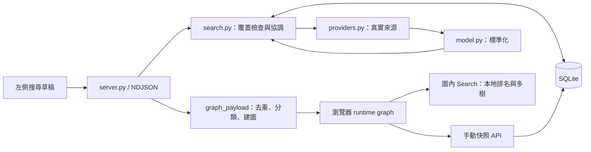

# 架構與模組責任

入口：[PROJECT_MAP.md](PROJECT_MAP.md)。啟動：[RUNTIME.md](RUNTIME.md)。

## 系統與資料流

## 後端

| 檔案 | 職責／關鍵入口 |
| --- | --- |
| [server.py](../server.py) | ThreadingHTTPServer、靜態檔白名單、Handler、search_events、graph_payload |
| [news_atlas/providers.py](../news_atlas/providers.py) | urllib 來源請求、Massive 安全分頁、RSS、Budget、部分失敗 Batch |
| [news_atlas/regions.py](../news_atlas/regions.py) | RSS 版區、語系與 Yahoo 網域單一對照 |
| [news_atlas/credentials.py](../news_atlas/credentials.py) | 獨立主機金鑰、原子保存、檔案權限；不入新聞 DB |
| [news_atlas/search.py](../news_atlas/search.py) | normalize_request、帶版本／語系的 query_key、同查詢鎖、search_source |
| [news_atlas/storage.py](../news_atlas/storage.py) | SQLite 表、WAL、覆蓋新鮮度、快照及自訂分類 |
| [news_atlas/model.py](../news_atlas/model.py) | canonical_url、article、deduplicate、enrich、build_relations |
| [news_atlas/channels.py](../news_atlas/channels.py) | 預設／自訂分類、文字命中證據、分類版本 |
| [news_atlas/snapshots.py](../news_atlas/snapshots.py) | 儲存／驗證共用的欄位白名單、ID／來源／設定驗證 |
| [news_atlas/exploration.py](../news_atlas/exploration.py) | REST 用圖譜驗證、排名、森林、時間桶；不控制瀏覽器 |
| [news_atlas/api.py](../news_atlas/api.py) | 純轉換、唯讀快取與 capabilities 分派 |
| [news_atlas/openapi.py](../news_atlas/openapi.py) | 讀 canonical JSON Schema，產生 OpenAPI 3.1 |

每個搜尋來源並行工作，最多 3 workers；先送 cache，再送 status/source，最終 done。單一來源完成便更新圖譜，不等待全部來源。失敗不抹除已取得新聞。程序內 32 個分片鎖降低相同來源／query 重疊補抓；不是跨程序分散式鎖。

## 前端

[dist/index.html](../dist/index.html) 直接載入本地 JS；`dist/` 是手動維護的應用程式碼，**不是可刪除重建的輸出目錄**。

| 模組 | 責任 |
| --- | --- |
| [dist/app.js](../dist/app.js) | DOM、搜尋串流、runtime 狀態、存取 API、模式及焦點協調 |
| [dist/graph-view.js](../dist/graph-view.js) | 來源選擇／分組、快照投影、edge 門檻、traceMany、rankRoots |
| [dist/timeline.js](../dist/timeline.js) | UTC 時間軸、密度格、逐篇節點、分類篩選 |
| [dist/interaction.js](../dist/interaction.js) | 自適應吸附、節點拖拉、Ctrl 平移、閒置計時 |
| [dist/glow.js](../dist/glow.js) | WebGL 同幀 Canvas 光暈、漸變、獨立材質處理 |
| [dist/explorer-ui.js](../dist/explorer-ui.js) | localStorage、搜尋草稿／key、JSON tree、面板拖曳與寬度 |
| [dist/date-range.js](../dist/date-range.js) | 自訂日期、快速月份與草稿序列化 |
| [dist/i18n.js](../dist/i18n.js) | 繁中／英文介面，不翻譯 `.raw` 新聞或證據 |

內附 3d-force-graph 與 Swagger vendor。優先讀 adapter，不要廣泛搜尋 minified bundle。不是 React／Next／npm 專案。

## 改動邊界

更改來源或快取語義先看 [SOURCES_AND_CACHE.md](SOURCES_AND_CACHE.md)；調整顯示門檻不應改寫來源證據。瀏覽器與 Python 各有排名實作，規則變更需保持一致並更新測試／API method。詳細合約見 [BEHAVIOR_CONTRACTS.md](references/BEHAVIOR_CONTRACTS.md)。

`dist/time-lens.js`：日期鐘形增益編輯器及同幀 mesh scale 更新；依賴 AtlasTimeline.timeSettings/timeScale，調整 node 尺寸而不改 graphData、物理或相機。

`run.sh`／`scripts/launch.py`：終端選單與程序生命週期。引用 server.Handler／ThreadingHTTPServer，不啟動第二份 HTTP 實作；Local 綁 0.0.0.0，Tailscale 綁 loopback 並管理單一前景 Serve 子程序。
